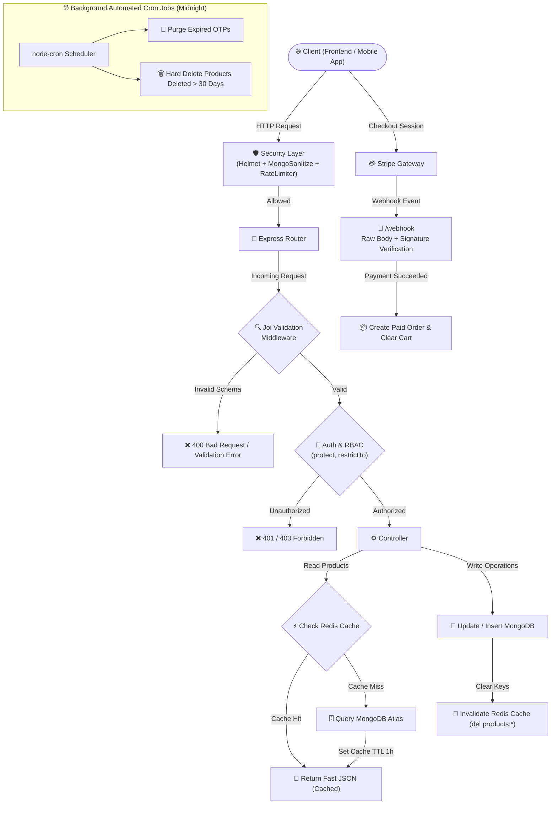

# 🍽️ Restaurant E-Commerce & Management System Backend API

<div align="center">


<p align="center">
  <b>نظام متكامل ومحرك خلفي (Enterprise-Grade RESTful API) لإدارة المطاعم وطلبات الأونلاين، مصمم بأحدث المعايير البرمجية مع التركيز على الأداء العالي والأمان والموثوقية.</b>
</p>

[📚 استعراض التوثيق التفاعلي (Swagger)](#-توثيق-الـ-api-التفاعلي-swagger-ui) •
[🏗️ الهيكلية المعمارية](#-الهيكلية-والمعمارية-architecture--system-design) •
[🚀 التشغيل السريع](#-دليل-التشغيل-والتثبيت-quick-start) •
[🔐 الأمان والصلاحيات](#-معايير-الأمان-وحماية-البيانات-security--protection) •
[📡 دليل الـ Endpoints](#-دليل-نقاط-الاتصال-api-reference)

---

</div>

## 📖 جدول المحتويات (Table of Contents)
- [نظرة عامة على النظام (Executive Summary)](#-نظرة-عامة-على-النظام-executive-summary)
- [أبرز المميزات البرمجية (Core Features)](#-أبرز-المميزات-البرمجية-core-features)
- [الهيكلية والمعمارية (Architecture & System Design)](#-الهيكلية-والمعمارية-architecture--system-design)
- [حزمة التقنيات المستخدمة (Tech Stack)](#-حزمة-التقنيات-المستخدمة-tech-stack)
- [هيكل المشروع ومجلداته (Project Structure)](#-هيكل-المشروع-ومجلداته-project-structure)
- [المتغيرات البيئية (Environment Variables)](#-المتغيرات-البيئية-environment-variables)
- [دليل التشغيل والتثبيت (Quick Start)](#-دليل-التشغيل-والتثبيت-quick-start)
- [دليل نقاط الاتصال (API Reference)](#-دليل-نقاط-الاتصال-api-reference)
- [محرك الدفع الإلكتروني و الـ Webhooks (Stripe Engine)](#-محرك-الدفع-الإلكتروني-و-الـ-webhooks-stripe-engine)
- [نظام الكاشينج بالـ Redis (Redis Caching Strategy)](#-نظام-الكاشينج-بالـ-redis-redis-caching-strategy)
- [المهام المجدولة (Automated Cron Jobs)](#-المهام-المجدولة-automated-cron-jobs)
- [معايير الأمان وحماية البيانات (Security & Protection)](#-معايير-الأمان-وحماية-البيانات-security--protection)
- [النشر السحابي (Deployment)](#-النشر-السحابي-deployment)

---

## 🌟 نظرة عامة على النظام (Executive Summary)

يقدم هذا المشروع بنية تحتية برمجية متطورة لإدارة منصات المطاعم والمتاجر الغذائية الإلكترونية. صُمم الـ Backend وفق مبادئ **Clean Architecture** ونمط **Layered MVC (Model - View/Route - Controller)** لضمان قابلية التوسع والصيانة العالية (Scalability & Maintainability).

يتعامل النظام مع كافة الجوانب التشغيلية: بدءاً من تسجيل العملاء بنظام التحقق برقم الهاتف، استعراض القوائم والوجبات، إدارة سلة التسوق الذكية، تطبيق الخصومات والكوبونات، تنفيذ عمليات الدفع (كاش أو أونلاين عبر Stripe)، مروراً بنظام تقييم المنتجات للمشترين الفعليين فقط، وحتى لوحة تحكم وإحصائيات مخصصة للمسؤولين (Admin Analytics).

---

## ⚡ أبرز المميزات البرمجية (Core Features)

### 1. 🛡️ إدارة الهوية والأمان (Auth & Identity Management)
* **JWT Authentication:** مصادقة الجلسات عبر JSON Web Tokens المحمية بنظام Bearer Token.
* **Role-Based Access Control (RBAC):** تقييد صلاحيات المسارات بدقة بين المستخدم العادي (`user`) ومدير النظام (`admin`).
* **Phone-based OTP Recovery:** استعادة كلمات المرور عبر إرسال كود OTP مؤقت (6 أرقام) مشفر بخوارزمية `SHA-256` مع مدة صلاحية محددة بـ 10 دقائق.
* **Account Lifecycle:** إمكانية حذف الحساب وتحديث البيانات بأمان مع منع الحسابات المحذوفة من تسجيل الدخول.

### 2. 🍔 إدارة المنتجات والتصنيفات (Menu & Categories)
* **Advanced Query Engine:** دعم الفلترة المتقدمة عبر الـ URL Query (`gte`, `gt`, `lte`, `lt`)، والبحث بالكلمات المفتاحية (`keyword`)، الترتيب (`sort`)، وتحديد الحقول (`fields`).
* **Pagination Support:** تقسيم نتائج الاستعلامات لصفحات لتوفير استهلاك الذاكرة وسرعة الاستجابة.
* **Soft Delete Pattern:** دعم الحذف المنطقي للمنتجات لحماية سجلات الطلبات التاريخية.
* **Automatic Slug Generation:** إنشاء مسارات وروابط سيو سهلة القراءة باستخدام `slugify`.
* **Image Uploads:** رفع صور المنتجات والتحقق من نوعها وصيغتها وحجمها عبر `multer`.

### 3. 🚀 الأداء العالي والتخزين المؤقت (High-Performance Redis Caching)
* دمج **Upstash Redis** السحابي لتخزين استعلامات المنتجات وقوائم الطعام في الكاش (TTL: 1 Hour).
* **Smart Cache Invalidation:** تنظيف وتحديث الكاش تلقائياً وبشكل فوري بمجرد إضافة أو تعديل أو حذف أي منتج لضمان دقة وتطابق البيانات (Cache Consistency).

### 4. 🛒 سلة المشتريات والكوبونات (Cart & Promotion Engine)
* احتساب تلقائي للمجموع الإجمالي ومجاميع الخصومات بناءً على نسبة خصم المنتج والكمية.
* فحص توفر المنتج وصلاحيته قبل إضافته للسلة.
* محرك قسائم الشراء (Coupons) مع التحقق من تاريخ انتهاء الصلاحية ونسبة الخصم وتطبيقها الفوري على إجمالي السلة.

### 5. 💳 نظام الدفع والطلبات (Orders & Payment Processing)
* **الدفع عند الاستلام (Cash on Delivery - COD):** إنشاء طلب كاش بضغطة زر مع تصفير السلة.
* **بوابة الدفع الإلكتروني (Stripe Checkout Session):** توليد جلسات دفع إلكتروني بالعملة المحلية (EGP) مع تسجيل بيانات العميل وعنوان التوصيل.
* **معالجة الـ Webhooks الآمنة:** استماع مباشر لحدث `checkout.session.completed` والتحقق من التوقيع الرقمي (`Stripe Signature`) لإنشاء الطلب وتأكيد الدفع تلقائياً.
* **Rate-Limiting on Orders:** منع التكرار العرضي للطلبات بمهلة إجبارية (Cooldown) مدتها دقيقة بين الطلب والآخر لنفس العميل لمنع هجمات Spamming.

### 6. ⭐ تقييمات المشترين المؤكدين فقط (Verified Buyers Reviews)
* لا يُسمح بإضافة تقييم أو كتابة مراجعة للمنتج إلا إذا كان المستخدم قد قام بشرائه بالفعل وكان الطلب بحالة **تم التوصيل (`delivered`)**.
* منع تكرار التقييم لنفس المنتج من قبل نفس المستخدم مع احتساب متوسط التقييمات تلقائياً.

### 7. ⏰ مهام التنظيف المؤتمتة (Automated Cron Jobs)
* مهمة مجدولة يومياً في تمام منتصف الليل (`0 0 * * *`) لتنظيف أكواد التحقق (OTPs) المنتهية.
* تفريغ وحذف المنتجات المحذوفة منطقياً (Soft Deleted) التي مر عليها أكثر من 30 يوماً من قاعدة البيانات نهائياً.

### 8. 📊 لوحة تحكم المدير (Admin Dashboard & Analytics)
* واجهة موحدة لجلب إحصائيات النظام الفورية: إجمالي المستخدمين النشطين، إجمالي المنتجات، إجمالي الطلبات، ومجموع الإيرادات المحصلة من الطلبات المكتملة عبر MongoDB Aggregation Pipeline.

---

## 🏗️ الهيكلية والمعمارية (Architecture & System Design)

### مخطط سير الطلب (Request Lifecycle Flow)



---

## 🛠️ حزمة التقنيات المستخدمة (Tech Stack)

| المجال | التقنية | الوصف / الفائدة |
| :--- | :--- | :--- |
| **بيئة التشغيل** | **Node.js (ES Modules)** | بيئة تشغيل سريعة مع معيار استيراد الوحدات الحديث (`import/export`). |
| **إطار العمل** | **Express 5.x** | أحدث إصدارات Express مع دعم استثنائي للـ Promises و Async Handlers. |
| **قاعدة البيانات** | **MongoDB & Mongoose 9.x** | قاعدة بيانات NoSQL مرنة مع نمذجة بيانات قوية وعلاقات Schema محكمة. |
| **التخزين المؤقت** | **Redis (Upstash)** | كاش سحابي عالي السرعة لتقليل زمن الاستجابة (Latency) وتخفيف الحمل على قاعدة البيانات. |
| **بوابة الدفع** | **Stripe SDK** | إدارة بطاقات الائتمان، Checkout Sessions، والتكامل مع Webhook Events. |
| **التوثيق التفاعلي**| **Swagger / OpenAPI** | توثيق تفاعلي مجاني ومباشر من المتصفح عبر `swagger-ui-express`. |
| **الأمان والحماية** | **Helmet & Mongo-Sanitize** | تأمين الترويسات (Headers) ومنع ثغرات NoSQL Injection و XSS. |
| **محدد الطلبات** | **Express Rate Limit** | الحماية من هجمات حجب الخدمة (DDoS / Brute-force). |
| **التحقق من المدخلات**| **Joi** | التحقق الدقيق من صحة وصيغة الحقول في الـ Body والـ Params والـ Query. |
| **المهام المؤتمتة** | **node-cron** | جدولة المهام الخلفية لتشغيلها تلقائياً بدون تدخل بشري. |
| **رفع الملفات** | **Multer** | معالجة وتخزين صور الوجبات والمنتجات محلياً في سيرفر التخزين. |

---

## 📂 هيكل المشروع ومجلداته (Project Structure)

```text
app-express/
├── 📁 config/                      # ملفات الربط والتهيئة للخدمات الخارجية
│   ├── db.js                      # تهيئة الاتصال بقاعدة بيانات MongoDB Atlas
│   └── redis.js                   # تهيئة عميل Upstash Redis السحابي
│
├── 📁 controllers/                 # منطق الأعمال (Business Logic Execution)
│   ├── admin.controller.js        # إحصائيات لوحة التحكم للإدارة
│   ├── auth.controller.js         # دوال OTP واسترجاع كلمة المرور
│   ├── cart.controller.js         # عمليات إضافة وتعديل وتفريغ السلة
│   ├── category.controller.js     # إدارة أقسام وتصنيفات المنيو
│   ├── coupon.controller.js       # إنشاء وتطبيق قسائم الخصم
│   ├── order.controller.js        # إنشاء الطلبات و Stripe Checkout والـ Webhook
│   ├── product.controller.js      # عمليات CRUD للمنتجات والبحث والكاشينج
│   ├── review.controller.js       # إضافة ومراجعة تقييمات العملاء الموثوقين
│   └── user.controller.js         # الملف الشخصي وإدارة المستخدمين
│
├── 📁 middlewares/                 # البرمجيات الوسيطة
│   ├── authMiddleware.js          # فحص توكن JWT والتحقق من الأدوار (RBAC)
│   ├── errorMiddleware.js         # معالج الأخطاء المركزي الموحد (Global Error Handler)
│   ├── uploadMiddleware.js        # وسيط رفع وتسمية الصور عبر Multer
│   └── validateMiddleware.js      # التحقق من مطابقة البيانات لمخططات Joi
│
├── 📁 modules/                     # طبقة البيانات والمخططات (Data Models & Schemas)
│   ├── cart/                      # Cart.model.js & Cart.validation.js
│   ├── category/                  # Category.model.js & Category.validation.js
│   ├── coupon/                    # Coupon.model.js & Coupon.validation.js
│   ├── order/                     # Order.model.js & Order.validation.js
│   ├── product/                   # Product.model.js & Product.validation.js
│   ├── review/                    # Review.model.js & Review.validation.js
│   └── user/                      # User.model.js & User.validation.js
│
├── 📁 routers/                     # مسارات التطبيق (API Routing Layer)
│   ├── admin.routes.js            # مسارات /admin
│   ├── cart.routes.js             # مسارات /cart
│   ├── category.routes.js         # مسارات /category
│   ├── coupons.routes.js          # مسارات /coupon
│   ├── order.routes.js            # مسارات /order
│   ├── product.routes.js          # مسارات /product
│   ├── review.routes.js           # مسارات /reviews
│   └── user.routes.js             # مسارات /users
│
├── 📁 uploads/                     # المجلد الفيزيائي لحفظ الصور المرفوعة
├── 📁 utils/                       # الأدوات المساعدة والمشتركة
│   ├── AppError.js                # صنف مخصص لإنشاء أخطاء تشغيلية بكود حالة محدد
│   ├── asyncHandler.js            # Wrapper للتخلص من كتل try-catch المتكررة
│   ├── cronJobs.js                # الجدولة الزمنية لتنظيف البيانات المهملة
│   └── jwt.js                     # دوال تشفير وفك توكن الـ JWT
│
├── .env                           # ملف المتغيرات البيئية الحساسة
├── .gitignore                     # الملفات المستبعدة من مستودع Git
├── package.json                   # تبعيات المشروع وأوامر التشغيل
├── server.js                      # نقطة الدخول الرئيسية للتطبيق (Entry Point)
├── swagger.js                     # مولد وثائق Swagger التلقائي
├── swagger-output.json            # مواصفات الـ API المستخرجة بصيغة JSON
└── vercel.json                    # إعدادات النشر على منصة Vercel السحابية
```

---

## 🔐 المتغيرات البيئية (Environment Variables)

قم بإنشاء ملف باسم `.env` في المجلد الرئيسي وضع فيه القيم المناسبة:

```env
# منفذ الخادم
PORT=3000

# رابط الاتصال بقاعدة بيانات مونجو
MONGO_URL=mongodb+srv://<username>:<password>@cluster.mongodb.net/restaurant_db

# المفتاح السري لتوقيع توكن المصادقة (JWT)
JWT_SECRET=your_super_secret_jwt_key_here

# بيانات بوابة الدفع الإلكتروني (Stripe)
STRIPE_SECRET=sk_test_51UTK...
STRIPE_WEBHOOK_SECRET=whsec_9f93...

# رابط الاتصال بـ Upstash Redis السحابي
REDIS_URL=rediss://default:<password>@<host>.upstash.io:6379

# بيئة التشغيل (development | production)
NODE_ENV=development
```

---

## 🚀 دليل التشغيل والتثبيت (Quick Start)

### المتطلبات المسبقة (Prerequisites)
* تثبيت **Node.js** (الإصدار 18 أو أحدث)
* حساب وقاعدة بيانات على **MongoDB Atlas** (أو MongoDB محلي)
* حساب **Upstash Redis** (أو سيرفر Redis محلي)
* حساب تجريبي على منصة **Stripe** للحصول على مفاتيح API

### خطوات التثبيت:

1. **استنساخ المستودع (Clone the repository):**
   ```bash
   git clone <REPO_URL>
   cd "app express"
   ```

2. **تثبيت الحزم والمكتبات (Install Dependencies):**
   ```bash
   npm install
   ```

3. **إعداد المتغيرات البيئية:**
   قم بنسخ الإعدادات الموجودة بالأعلى إلى ملف `.env` واملأ المفاتيح الصحيحة.

4. **توليد توثيق Swagger (اختياري عند تحديث المسارات):**
   ```bash
   node swagger.js
   ```

5. **بدء تشغيل السيرفر في وضع التطوير (Development Mode):**
   ```bash
   npm run dev
   ```
   *سيعمل السيرفر افتراضياً على الرابط:* `http://localhost:3000`

---

## 📚 توثيق الـ API التفاعلي (Swagger UI)

يحتوي النظام على توثيق تفاعلي كامل مدمج، يمكنك من خلاله تجربة جميع الـ Endpoints وتمرير ترويسة المصادقة `Bearer Token` مباشرة من المتصفح:

📍 **رابط التوثيق المحلي:** [https://restaurant-api-ruddy.vercel.app/api-docs/](https://restaurant-api-ruddy.vercel.app/api-docs/)

---

## 📡 دليل نقاط الاتصال (API Reference)

### 1. المستخدمون والمصادقة (`/users`)

| الطريقة | المسار (Endpoint) | الصلاحية (Access) | الوصف |
| :--- | :--- | :--- | :--- |
| `POST` | `/users/register` | عام (Public) | إنشاء حساب مستخدم جديد |
| `POST` | `/users/login` | عام (Public) | تسجيل الدخول واستلام توكن JWT |
| `GET` | `/users/me` | مسجل دخول (`protect`) | جلب بيانات الحساب الحالي |
| `PATCH`| `/users/update-password` | مسجل دخول (`protect`) | تغيير كلمة المرور |
| `PATCH`| `/users/update-me` | مسجل دخول (`protect`) | تعديل بيانات الحساب (الاسم، الهاتف) |
| `DELETE`| `/users/delete-me` | مسجل دخول (`protect`) | حذف منطقي للحساب الحالي (`DELETED`) |
| `POST` | `/users/forgot-password`| عام (Public) | طلب إرسال رمز OTP لاستعادة كلمة المرور |
| `POST` | `/users/verify-code` | عام (Public) | التحقق من صحة كود OTP المدخل |
| `PUT` | `/users/reset-password` | عام (Public) | تعيين كلمة المرور الجديدة بعد تأكيد OTP |
| `GET` | `/users` | مسؤول فقط (`admin`) | عرض قائمة بجميع المستخدمين المسجلين |
| `GET` | `/users/:id` | مسؤول فقط (`admin`) | جلب تفاصيل مستخدم محدد بواسطة معرفه |

<details>
<summary><b>عرض نموذج طلب تسجيل الدخول (Payload Example)</b></summary>

```json
// POST /users/login
{
  "phone": "01012345678",
  "password": "Password123@"
}
```
</details>

---

### 2. التصنيفات والقوائم (`/category`)

| الطريقة | المسار (Endpoint) | الصلاحية (Access) | الوصف |
| :--- | :--- | :--- | :--- |
| `GET` | `/category` | عام (Public) | جلب جميع تصنيفات الطعام |
| `GET` | `/category/:id` | عام (Public) | جلب تصنيف محدد بالـ ID |
| `POST` | `/category` | مسؤول فقط (`admin`) | إضافة تصنيف جديد مع توليد الـ Slug |
| `PATCH`| `/category/:id` | مسؤول فقط (`admin`) | تعديل بيانات التصنيف |
| `DELETE`| `/category/:id` | مسؤول فقط (`admin`) | حذف تصنيف من النظام |

---

### 3. وجبات الطعام والمنتجات (`/product`)

| الطريقة | المسار (Endpoint) | الصلاحية (Access) | الوصف |
| :--- | :--- | :--- | :--- |
| `GET` | `/product` | عام (Public - Cached) | جلب المنتجات مع الفلترة والبحث والترتيب والصفحات |
| `GET` | `/product/discounted-products` | عام (Public - Cached) | جلب المنتجات التي تحتوي على خصومات فعالة |
| `GET` | `/product/:id` | عام (Public - Cached) | جلب تفاصيل وجبة محددة بالمعرف |
| `POST` | `/product` | مسؤول فقط (`admin`) | إضافة وجبة جديدة مع صورة (Multer upload) وتفريغ الكاش |
| `PATCH`| `/product/:id` | مسؤول فقط (`admin`) | تعديل الوجبة وتحديث صورتها إن وجدت وتفريغ الكاش |
| `DELETE`| `/product/:id` | مسؤول فقط (`admin`) | حذف منطقي للمنتج (`soft delete`) وتفريغ الكاش |

#### 💡 أمثلة على الفلترة والبحث المتقدم في المنتجات:
* البحث بالكلمة المفتاحية: `/product?keyword=Burger`
* الفلترة حسب السعر: `/product?price[gte]=50&price[lte]=200`
* الترتيب حسب السعر تنازلياً: `/product?sort=-price`
* اختيار حقول محددة وتحديد الصفحة: `/product?fields=name,price,image&page=1&limit=5`

---

### 4. سلة المشتريات (`/cart`)

| الطريقة | المسار (Endpoint) | الصلاحية (Access) | الوصف |
| :--- | :--- | :--- | :--- |
| `GET` | `/cart` | عميل فقط (`user`) | عرض محتويات سلة التسوق للمستخدم الحالي |
| `POST` | `/cart` | عميل فقط (`user`) | إضافة منتج للسلة مع حساب السعر بعد الخصم |
| `PUT` | `/cart` | عميل فقط (`user`) | تعديل كمية منتج موجود داخل السلة |
| `DELETE`| `/cart/:id` | عميل فقط (`user`) | إزالة منتج معين من السلة |
| `DELETE`| `/cart` | عميل فقط (`user`) | تفريغ السلة بالكامل |

---

### 5. قسائم الخصم الكوبونات (`/coupon`)

| الطريقة | المسار (Endpoint) | الصلاحية (Access) | الوصف |
| :--- | :--- | :--- | :--- |
| `POST` | `/coupon` | مسؤول فقط (`admin`) | إنشاء كود خصم جديد مع نسبة الخصم وتاريخ الانتهاء |
| `GET` | `/coupon` | مسؤول فقط (`admin`) | استعراض كافة قسائم الخصم في النظام |
| `PUT` | `/coupon/apply-coupon` | عميل فقط (`user`) | تطبيق الكوبون وتخفيض قيمة سلة العميل الحالية |

---

### 6. الطلبات والمدفوعات (`/order`)

| الطريقة | المسار (Endpoint) | الصلاحية (Access) | الوصف |
| :--- | :--- | :--- | :--- |
| `POST` | `/order/:id` | عميل فقط (`user`) | إنشاء طلب بالدفع عند الاستلام (Cash on Delivery) |
| `POST` | `/order/checkout-session/:id` | عميل فقط (`user`) | توليد رابط دفع إلكتروني عبر Stripe Checkout |
| `POST` | `/webhook` | عام / سيرفر Stripe | استلام إشعارات الدفع التلقائية من Stripe وتأكيد الطلب |
| `GET` | `/order` | مسؤول فقط (`admin`) | جلب جميع طلبات المستخدمين وحالات التوصيل |
| `PUT` | `/order/:id/status`| مسؤول فقط (`admin`) | تحديث حالة الطلب (`pending`, `in-progress`, `delivered`, `cancelled`) |

---

### 7. التقييمات والمراجعات (`/reviews`)

| الطريقة | المسار (Endpoint) | الصلاحية (Access) | الوصف |
| :--- | :--- | :--- | :--- |
| `GET` | `/reviews` | عام (Public) | عرض جميع المراجعات (مع إمكانية الفلترة بالمنتج) |
| `POST` | `/reviews` | عميل فقط (`user`) | إضافة مراجعة وتقييم (يشترط استلام المنتج مسبقاً) |

---

### 8. إحصائيات الإدارة (`/admin`)

| الطريقة | المسار (Endpoint) | الصلاحية (Access) | الوصف |
| :--- | :--- | :--- | :--- |
| `GET` | `/admin/stats` | مسؤول فقط (`admin`) | لوحة معلومات شاملة (عدد المستخدمين، الطلبات، الوجبات، وإجمالي الأرباح) |

---

## 💳 محرك الدفع الإلكتروني و الـ Webhooks (Stripe Engine)

تعتمد معمارية الدفع على فصل عملية إنشاء الجلسة عن عملية تأكيد الطلب الفعلي لضمان أعلى درجات الأمان:

1. **العميل يطلب الدفع:** يرسل العميل طلبه إلى `/order/checkout-session/:cartId` مع عنوان التوصيل.
2. **إنشاء جلسة Stripe:** يقوم السيرفر بإنشاء `Stripe Checkout Session` وتمرير `client_reference_id` (معرف السلة) و `metadata` (معرف المستخدم وعنوان الشحن).
3. **الدفع الآمن:** يتم تحويل العميل إلى بوابة Stripe لإتمام الدفع ببطاقته البنكية.
4. **تأكيد الطلب عبر الـ Webhook:**
   * يرسل Stripe حدث `checkout.session.completed` إلى الرابط `/webhook`.
   * يتم استلام الـ Body بصيغته الخام (`express.raw`) والتحقق من التوقيع الرقمي عبر الـ `STRIPE_WEBHOOK_SECRET`.
   * بعد التحقق، يتم إنشاء سجل الطلب (`Order`) في قاعدة البيانات مع علامة `isPaid: true`، وتفريغ سلة المشتريات تلقائياً.

---

## ⚡ نظام الكاشينج بالـ Redis (Redis Caching Strategy)

لضمان أقصى سرعة استجابة لقوائم الطعام وتخفيف الاستعلامات على MongoDB، تم بناء استراتيجية كاشينج ذكية:

* **مفتاح الكاش (Cache Key):** يعتمد على الـ URL الكامل للطلب متضمناً الـ Query Parameters (مثل: `products:/product?keyword=pizza&page=1`).
* **مدة البقاء (TTL):** يتم حفظ البيانات لمدة **ساعة واحدة (3600 ثانية)**.
* **إلغاء الصلاحية الفوري (Cache Invalidation):** في حال حدوث أي عملية كتابة (إضافة وجبة، تعديل بيانات وجبة، أو حذف وجبة)، يتم تنفيذ:
  ```javascript
  const keys = await redisClient.keys("products:*");
  if (keys.length > 0) await redisClient.del(keys);
  ```
  هذا يضمن أن العملاء لا يرون أبداً بيانات قديمة عند قيام المدير بتعديل الأسعار أو الوجبات.

---

## ⏰ المهام المجدولة (Automated Cron Jobs)

باستخدام مكتبة `node-cron`، تعمل العمليات التالية تلقائياً في الخلفية بدون أي تأثير على أداء الـ API:

```cron
# توقيت التشغيل: كل يوم الساعة 00:00 (منتصف الليل)
0 0 * * *
```

1. **تنظيف أكواد التحقق (OTP Expiration Cleanup):**
   * إزالة حقول `passwordResetCode` و `passwordResetExpires` من حسابات المستخدمين التي تجاوزت صلاحيتها الوقت الحالي لحماية خصوصية الحسابات.
2. **التنظيف النهائي للمنتجات المحذوفة (Purge Soft-Deleted Products):**
   * حذف كافة المنتجات المسجلة بحالة `status: "deleted"` نهائياً من الـ Database إذا مر على تاريخ حذفها أكثر من **30 يوماً**.

---

## 🛡️ معايير الأمان وحماية البيانات (Security & Protection)

تم تطبيق أفضل الممارسات المتبعة في كبرى الشركات البرمجية لحماية النظام:

1. **Helmet HTTP Headers:** حماية الـ Headers وحجب معلومات السيرفر ومنع ثغرات Clickjacking.
2. **Data Sanitization against NoSQL Query Injection:** فحص وتطهير مدخلات المستخدمين في الـ `req.body` و `req.params` عبر `express-mongo-sanitize` لمنع محاولات حقن كويري المونجو الخبيثة (مثل `{ $gt: "" }`).
3. **Rate Limiting:** تطبيق حد أقصى للطلبات (100 طلب لكل 15 دقيقة لكل عنوان IP) لمنع هجمات الحرمان من الخدمة (DDoS).
4. **Body Payload Limiter:** قصر حجم البيانات الواردة في الـ JSON على `10kb` لمنع استنزاف ذاكرة السيرفر.
5. **Joi Schema Validation:** صمام أمان صارم لرفض أي طلب لا يطابق المواصفات المحددة قبل أن يصل إلى قواعد البيانات أو وحدات التحكم.
6. **Order Placement Cooldown:** منع المستخدم من إرسال أكثر من طلب خلال دقيقة واحدة لحماية المطعم من عمليات الاحتيال والتكرار غير المقصود.

---

## 🌐 النشر السحابي (Deployment)

تم تجهيز المشروع للنشر الفوري كـ Serverless Functions على منصة **Vercel** عبر ملف `vercel.json`:

```json
{
  "version": 2,
  "builds": [
    {
      "src": "server.js",
      "use": "@vercel/node"
    }
  ],
  "routes": [
    {
      "src": "/(.*)",
      "dest": "server.js"
    }
  ]
}
```

للنشر:
1. قم بربط مستودع GitHub بحسابك على [Vercel](https://vercel.com).
2. قم بإضافة كافة المتغيرات البيئية (Environment Variables) الموجودة في ملف `.env` داخل لوحة إعدادات Vercel.
3. اضغط **Deploy**.

---

## 👥 المساهمة والتطوير (Contribution)

نرحب بكافة المساهمات! إذا أردت تحسين المشروع أو إضافة ميزات جديدة:
1. قم بعمل Fork للمستودع.
2. أنشئ فرعاً لميزتك (`git checkout -b feature/AmazingFeature`).
3. قم بعمل Commit لتغييراتك (`git commit -m 'Add some AmazingFeature'`).
4. ارفع الفرع إلى GitHub (`git push origin feature/AmazingFeature`).
5. افتح طلب دمج (Pull Request).

---

<div align="center">
  <sub>تم إعداد هذا التوثيق البرمجي بأعلى معايير الجودة والاحترافية البرمجية 🚀</sub>
</div>
